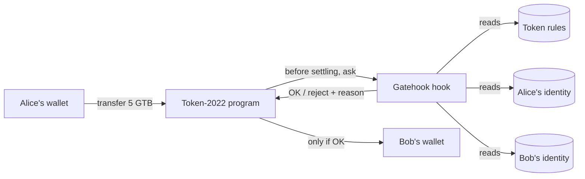
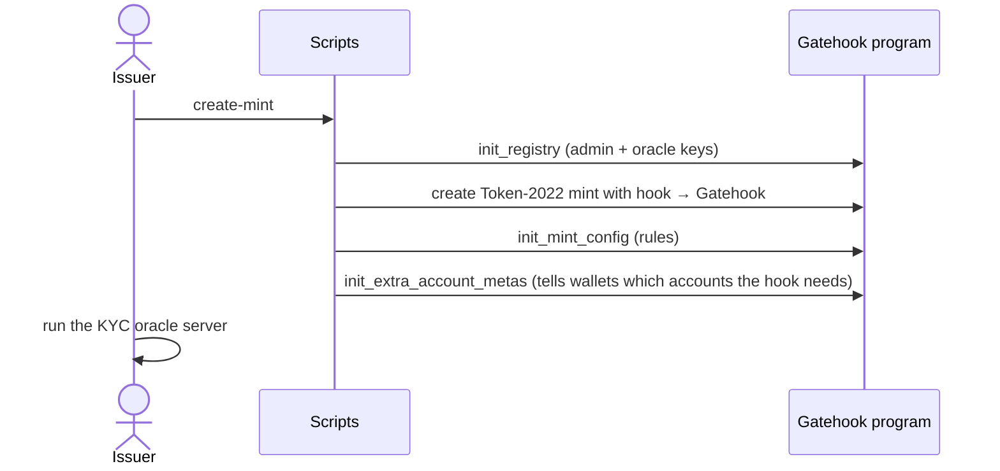
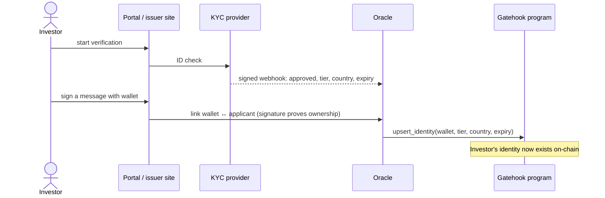
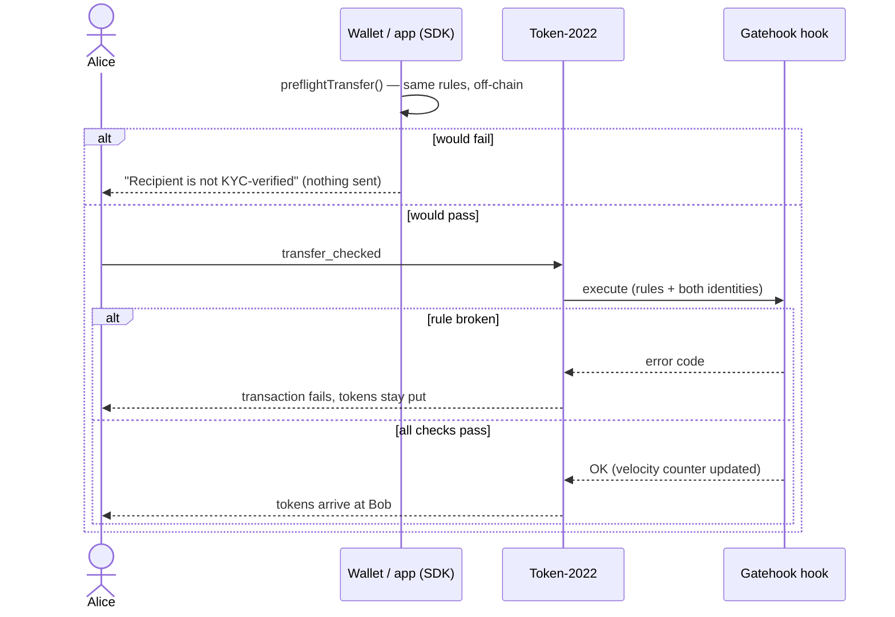

# How Gatehook works

A plain-language overview. For the full design see [`plan.md`](../plan.md);
for operating a token see the [issuer runbook](issuer-runbook.md).

## What it does

Gatehook makes a Solana token **only movable between approved investors**.

Real-world-asset tokens (tokenized T-bills, funds, private shares) come with
legal rules: only verified (KYC'd) people may hold them, some investors must
be accredited, some countries are excluded, newly issued tokens may be locked
for a while, and the issuer must be able to freeze or recover tokens.

Gatehook enforces those rules **on-chain, on every transfer**. A transfer
that breaks a rule simply fails, with a readable reason such as
"Recipient is not KYC-verified" or "Sender KYC has expired". Nobody has to
trust a website or a backend to do the checking.

Because it uses the standard Token-2022 *transfer hook* extension, wallets,
DEXs and other apps keep working: they send an ordinary `transfer_checked`,
and Solana runs the checks automatically.

## The idea in one picture



## The pieces

| Piece | What it is | Who uses it |
|---|---|---|
| **Program** (`programs/gatehook`) | The on-chain rulebook and the hook that runs on every transfer | Solana itself |
| **KYC oracle** (`oracle/`) | A server that receives KYC results from a verification provider and writes investor identities on-chain | The issuer runs it |
| **SDK** (`sdk/`) | TypeScript library: build compliant transfers, check a transfer *before* sending it, translate errors | Wallets, DEXs, apps |
| **Scripts** (`scripts/`) | Command-line tools to create a token, add investors, demo transfers | The issuer |
| **Portal** (`portal/`) | A demo investor website: verify, link wallet, get test tokens, send | Investors (demo) |

### What is stored on-chain

| Record | One per | Holds |
|---|---|---|
| **Registry** | issuer | who the admin is, who the oracle is |
| **Rules** (`ComplianceConfig`) | token | pause switch, allowed tiers and countries, transfer cap, lockups, velocity limits |
| **Identity** | investor wallet, per issuer | KYC expiry date, investor tier, country, holding period, frozen flag |

One identity covers every token from the same issuer, so an investor
verifies once.

### Who can do what

| Role | Can | Cannot |
|---|---|---|
| **Admin** (issuer, ideally a multisig) | set rules, pause, freeze wallets, change the oracle, recover tokens | write KYC data |
| **Oracle** (KYC server key) | create and update identities | change rules, pause, freeze |
| **Investor** | hold and transfer, if the rules allow | anything else |

Splitting these powers means a leaked oracle key can't unpause a token or
move funds, and the admin can't fake someone's KYC.

## What is checked on every transfer

In order; the first failing check rejects the transfer:

1. **Token not paused.**
2. **Amount within the per-transfer cap.**
3. **Recipient is approved:** has an identity, isn't frozen, KYC not expired,
   tier allowed, country allowed, and not a US person if the token is Reg S.
4. **Sender is approved** (same checks).
5. **Lockups have passed:** the token's issuance lockup and the sender's own
   holding period.
6. **Velocity limit:** the sender hasn't moved more than their tier allows in
   the current time window.

Identities are looked up from who *owns* the token accounts, so routing a
transfer through a delegate or a DEX can't skip the checks.

**Recovery (clawback):** when the admin moves tokens as the token's permanent
delegate (court order, lost keys), sender rules are skipped, but the
recipient must still be an approved holder.

## The flow, step by step

### 1. Issuer sets up a token (once)



```bash
CLUSTER=devnet pnpm --filter @gatehook/scripts create-mint
pnpm --filter @gatehook/oracle start
```

### 2. Investor gets verified (once per investor)



Without the oracle (testing or manual onboarding), the issuer can attest a
wallet directly:

```bash
pnpm --filter @gatehook/scripts attest --wallet <ADDRESS> --tier accredited --country DE --days 365
```

### 3. Investor transfers tokens (every time)



The preflight is just for a better experience: the app can explain the
problem before the user pays a fee. The on-chain hook is what actually
enforces the rules.

```ts
import { getCompliantTransferInstruction, preflightTransferFromChain } from '@gatehook/sdk';
```

### 4. Ongoing operations

| Situation | What happens |
|---|---|
| KYC expires | Transfers start failing automatically on the expiry date; the oracle's sweeper notices and re-checks |
| Provider revokes KYC | Oracle sets the identity's expiry to 0, blocking the wallet immediately |
| Suspicious wallet | Admin freezes that identity |
| Incident | Admin pauses the whole token |
| Lost keys / court order | Admin claws back via the permanent delegate to an approved wallet |
| Rule change | Admin calls `update_config` (new caps, countries, limits) |

## Try it

The fastest way to see it is the demo portal against devnet:

```bash
pnpm install
pnpm --filter @gatehook/oracle start                                  # terminal 1
pnpm --filter @gatehook/portal build && pnpm --filter @gatehook/portal start   # terminal 2
```

Open http://127.0.0.1:8788 and follow the four steps:

1. **Sign in** with any email (demo session).
2. **Verify identity:** pick tier and country → **Complete KYC**.
3. **Link your wallet:** connect a wallet or **Use a burner wallet** →
   **Sign message to link wallet** → **Get 0.01 SOL + 100 GTB**.
4. **Hold & transfer:** send to an approved address (succeeds) and to an
   unverified one (blocked before sending, reason shown). **Revoke KYC** in
   step 2 and your own transfers start failing.

Setup for the `.env` files is in [`portal/README.md`](../portal/README.md);
devnet addresses are in [`deployments.md`](deployments.md).
